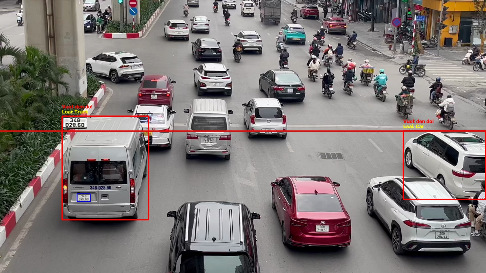
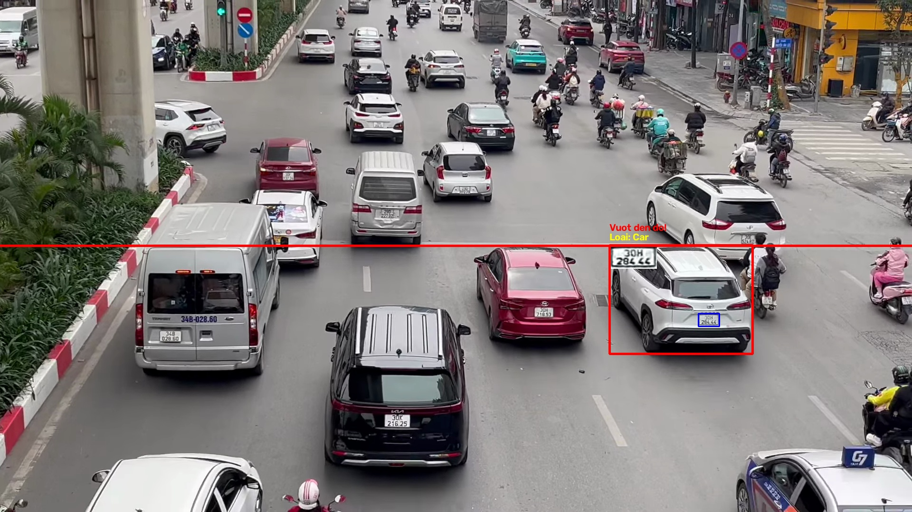
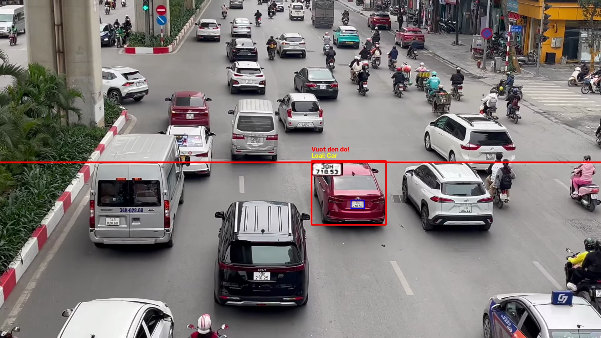

# Traffic Violation Detection System

Dự án thử nghiệm Computer Vision phát hiện phương tiện, theo dõi chuyển động, ghi nhận candidate cắt qua vạch và nhận diện biển số. Phase 01 đã tách AI core thành service Python modular để tích hợp Backend/queue/database trong các phase sau.

> **Lưu ý:** Hệ thống hiện chưa đọc trạng thái đèn giao thông. Crossing event chỉ là `LINE_CROSSING_CANDIDATE`, không phải xác nhận vi phạm pháp lý. Mọi kết quả phải được người có thẩm quyền kiểm tra.

## Phase 01 — Refactor AI Core

AI service mới nằm trong [`ai-service/`](ai-service/README.md) với các khả năng:

- Reusable YOLO `VehicleDetector`, resolve target class từ label thật của model.
- Stateful ByteTrack integration qua `VehicleTracker`.
- Temporal line crossing dùng bottom-center, direction, hysteresis và duplicate prevention.
- Tách `PlateDetector`, `PlateRecognizer` và context-aware `PlateValidator`.
- Headless `VideoProcessor`, không phụ thuộc `cv2.imshow()`.
- JSON contract có schema version, job/event UUID, nullable OCR fields và relative artifact paths.
- Evidence JPEG, optional annotated video và optional CSV/SQLite compatibility.
- YAML config, environment overrides, structured logging và CLI.
- Unit tests không cần model weights.

Tài liệu kỹ thuật:

- [Audit kiến trúc cũ và quyết định refactor](docs/PHASE_01_AUDIT.md)
- [Hướng dẫn AI service](ai-service/README.md)
- [Tổng kết Phase 01](docs/PHASE_01_SUMMARY.md)

## Kiến trúc

```text
Input video
    |
Vehicle detection + ByteTrack
    |
Temporal line-crossing analysis
    |
LINE_CROSSING_CANDIDATE
    |
Plate detection + EasyOCR + validation
    |
results.json + evidence images + optional annotated video
```

```text
.
├── ai-service/                     # AI core mới
│   ├── configs/
│   ├── models/                    # weights local, không commit
│   ├── src/traffic_ai/
│   ├── tests/
│   └── pyproject.toml
├── docs/
├── traffic_violation_detection.py  # legacy entry point, được giữ lại
├── license_plate_recognition.py     # legacy OCR pipeline
├── sort.py                          # legacy SORT demo, không dùng trong service mới
└── requirements.txt
```

## Cài đặt

Yêu cầu Python 3.10–3.12; khuyến nghị Python 3.11.

```bash
python3.11 -m venv .venv
source .venv/bin/activate
python -m pip install --upgrade pip
python -m pip install -e "ai-service[dev]"
```

`requirements.txt` ở repository root cài service mới và dependency cho legacy SORT demo:

```bash
python -m pip install -r requirements.txt
```

Nếu dùng GPU, cài PyTorch build phù hợp CUDA/MPS của máy. Không cò ghim cứng CUDA 11.8 cho mọi platform.

## Model weights

Không commit weights vào Git. Mặc định đặt tại:

```text
ai-service/models/yolov8m.pt
ai-service/models/license_plate_detector.pt
```

Có thể override path bằng `ai-service/configs/default.yaml`, `TRAFFIC_AI_VEHICLE_MODEL_PATH` và `TRAFFIC_AI_PLATE_MODEL_PATH`.

## Chạy AI service

```bash
python -m traffic_ai \
  --input /path/to/video.mp4 \
  --output /path/to/results
```

Tùy chọn:

```bash
python -m traffic_ai \
  --input /path/to/video.mp4 \
  --output /path/to/results \
  --device cpu \
  --annotated-video
```

Output chính là `results.json`; mỗi evidence path bên trong JSON tương đối với result directory.

## Chạy test

```bash
cd ai-service
../.venv/bin/python -m pytest
../.venv/bin/python -m pytest --cov=traffic_ai --cov-report=term-missing
```

Integration test tự skip nếu chưa cung cấp video và hai model weights. Xem lệnh opt-in trong [AI service README](ai-service/README.md#chạy-test).

## Kết quả minh họa

Baseline cũ với `7.mp4` xử lý 520 frame và ghi nhận 36 lượt bbox cắt qua vạch: 17 ô tô, 15 xe máy và 4 xe tải. Đây không phải accuracy benchmark và không phải số vi phạm đã xác minh.







## Legacy source

Ba file root `traffic_violation_detection.py`, `license_plate_recognition.py`, `sort.py` chưa bị xóa để bảo toàn chức năng và phục vụ đối chiếu. Chúng không phải entry point khuyến nghị cho tích hợp Backend mới.

`sort.py` mang thông báo GPL-3.0 từ upstream. AI service mới không import/copy implementation này; nó dùng ByteTrack thông qua Ultralytics. Cần review license toàn bộ dependency và model trước khi phân phối thương mại.

## Bảo mật và quyền riêng tư

Ảnh/video giao thông và biển số có thể là dữ liệu cá nhân. Chỉ xử lý dữ liệu bạn có quyền sử dụng, áp dụng retention/access policy phù hợp và không commit video, database, model weights hay output thật. `.gitignore` chỉ cho phép ba screenshot README đã chọn.

## Giới hạn hiện tại

- Tracking có thể ID-switch khi che khuất hoặc mật độ giao thông cao.
- Line coordinates phải hiệu chỉnh theo camera.
- OCR chưa có temporal aggregation/retry trên nhiều frame.
- Chưa có traffic signal recognition, perspective calibration hay speed estimation.
- Chưa tích hợp NestJS, PostgreSQL, Redis hoặc Docker trong Phase 01.
