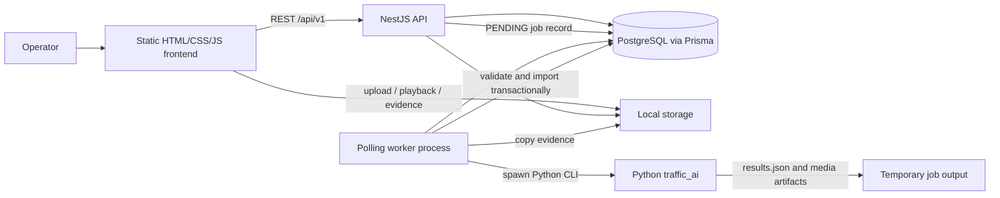

# AI Traffic Monitoring System

An engineering MVP for processing uploaded traffic videos, producing vehicle line-crossing candidates, recognizing license plates where image quality permits, and supporting human review through a web interface.

> **Status:** research and portfolio MVP. It is not a certified traffic-enforcement system and does not determine traffic-light state or establish a legal violation. A line-crossing event is an AI-generated candidate that requires human review.

## Project Overview

The repository contains a Python computer-vision pipeline, a TypeScript/NestJS API and PostgreSQL persistence layer, a polling background worker, and a static HTML/CSS/JavaScript frontend. The backend worker launches the Python package as a child process, validates its JSON result, and imports events and media evidence transactionally. The frontend supports video and job management, candidate review, evidence inspection, camera metadata, plate-crop review, and playback of the original video with event markers.

The Python service uses pretrained Ultralytics YOLO models for inference. The repository does not contain a model-training or fine-tuning workflow. Model weights are local, ignored files and must be obtained separately with appropriate rights; see [`ai-service/models/README.md`](ai-service/models/README.md).

## Problem Statement

Long traffic recordings are difficult to inspect manually. This MVP combines vehicle detection and tracking with a configurable virtual-line rule to identify candidate crossing moments, then attempts plate-region detection and OCR at those moments. The API stores the resulting job, event, review, and evidence metadata so an operator can inspect candidates. It is an assistance and review workflow, not an automatic adjudication tool.

## Key Features

| Capability | Implementation status |
|---|---|
| Vehicle inference and persistent tracking | Implemented; uses configured pretrained YOLO weights and Ultralytics tracking |
| Configurable virtual-line crossing candidates | Implemented; one candidate per track by default, direction and tolerance configurable |
| License-plate region detection and OCR | Implemented; results may be null when detection, crop quality, or OCR validation is insufficient |
| Asynchronous processing jobs | Implemented; database-polling worker claims pending jobs and launches Python |
| Strict AI-result validation and transactional import | Implemented; unsupported or malformed results fail the job with a diagnostic message |
| Video, event evidence, plate crop, annotated-video storage | Implemented when the corresponding artifact is produced |
| Dashboard, filtering, review, cameras, jobs, plate gallery, replay | Implemented in static frontend pages; automated browser coverage is not present |
| Traffic-light state and legal violation determination | Not implemented |
| Model training, benchmark evaluation, and production deployment | Not present in this repository |

## Technology Stack

| Area | Verified technologies |
|---|---|
| Vehicle / plate detection | Python, Ultralytics YOLO, OpenCV, NumPy |
| Tracking | Ultralytics tracking API with the repository's ByteTrack configuration |
| OCR | EasyOCR, OpenCV preprocessing |
| Python configuration and tests | PyYAML, pytest |
| API and worker | TypeScript, Node.js, NestJS, class-validator, Jest |
| Persistence | PostgreSQL, Prisma 7 with PostgreSQL driver adapter |
| Frontend | Plain HTML, CSS, browser JavaScript; no UI framework or bundler |
| Optional annotated video encoding | ffmpeg / libx264 |

## System Architecture



The API and worker are separate NestJS entry points. The worker uses a database polling loop and an atomic PostgreSQL claim query; there is no message broker in the implementation. It starts Python with `spawn`, passes the input and temporary output paths as CLI arguments, and imports the resulting JSON. The API does not run YOLO inside an HTTP request.

## Computer Vision Pipeline

### YOLOv8 Object Detection

`VehicleDetector` loads an Ultralytics YOLO checkpoint from configuration and performs frame-by-frame inference/tracking. The default configuration names `models/yolov8m.pt`, targets `car`, `motorcycle`, `bus`, and `truck`, and sets confidence `0.30`, IoU `0.50`, and image size `640`. Class names are resolved against the loaded checkpoint; missing configured classes cause model initialization to fail. `device: auto` leaves accelerator selection to the library/runtime. The code supports explicit CPU/CUDA/MPS settings, but this repository does not provide a hardware benchmark.

The worker does not download weights. Checkpoints are ignored by Git and must be provisioned locally. No custom training, fine-tuning, or model provenance is claimed here.

### Tracking and Candidate Generation

The processor reads frames sequentially with OpenCV and calls the vehicle detector's tracking method with `configs/bytetrack.yaml` and persistent tracking enabled. Track IDs are used by the line-crossing detector to maintain side-of-line state and suppress duplicate candidates. The default line is horizontal at normalized `y=0.48`, direction `positive_to_negative`, tolerance `8` pixels, with repeated crossings disabled.

The tracked vehicle's bottom-center point is used for the line-side test. A transition across the configured line creates a `LINE_CROSSING_CANDIDATE`; this is not a red-light determination. The processor does not inspect a signal head, stop sign, or traffic-law context.

### License Plate OCR

At a candidate crossing frame, a separate YOLO plate detector searches inside that vehicle's bounding-box region. The current implementation selects the returned crop with the highest plate-detector confidence. Crops below the configured minimum dimension are not saved as plate-crop evidence. EasyOCR processes the crop; configured preprocessing converts it to grayscale, applies bilateral filtering and histogram equalization, adaptive thresholding, morphological closing, and sharpening. `PlateValidator` normalizes candidate text against supported plate-shape patterns and applies a minimum OCR confidence threshold. It can apply role-based character substitutions during normalization; this is not temporal or cross-frame confidence aggregation.

The schema distinguishes normalized `plate_number`, raw OCR text, and OCR confidence. If validation does not produce a valid normalized plate, `plate_number` remains null; a raw candidate may still be retained. A missing plate is not proof that the vehicle was absent. Camera distance and image resolution limit available plate pixels.

The repository's documented 7.mp4 observation used 48 line-crossing tracks at 1920×1080. At the crossing frame, 22/48 tracks had a plate crop (median width 34 px, P90 38.6 px, maximum 45 px). Across the next 30 frames, 25/48 had a crop (median 34 px, P90 43.2 px, maximum 59 px); none reached 60 px in either group. The median width improvement was about one pixel, so best-of-next-frames selection was not implemented. This observation is not an OCR accuracy benchmark.

### Evidence and Annotated Video

Event evidence consists of per-event image and optional plate-crop files. The optional `annotated_video.mp4` is encoded with ffmpeg as H.264/yuv420p when enabled and ffmpeg is available; failure to create it is logged without failing the processing job. Annotated video may include vehicle imagery and plate information and should be handled as personal data. Evidence images and video artifacts are copied by the importer into backend local storage.

## Traffic Violation Processing

Only virtual-line crossing candidate generation is operational. Detection, OCR, and candidate generation are separate stages: YOLO identifies vehicle objects; the plate detector/OCR attempts to read a plate; the spatial/temporal line rule emits a candidate event. There is no red-light, speed-limit, lane, helmet, or signal-state classifier. Human review statuses are `PENDING_REVIEW`, `VERIFIED_CROSSING`, and `REJECTED_CANDIDATE`; “verified crossing” records a review decision about the candidate and does not assert a legally established red-light violation.

## Backend Architecture

The backend is a NestJS REST API with a separate worker entry point. Controllers expose DTO-validated routes; services contain persistence and file operations; Prisma accesses PostgreSQL; `LocalStorageService` resolves storage keys beneath a configured storage root. Global request validation uses `whitelist: true` and `forbidNonWhitelisted: true`. A shared exception filter formats API errors.

The internal shared token guard protects state-changing routes and media content routes. It is not end-user authentication, role-based access control, or a multi-user identity system. Public portfolio deployments should add a suitable authentication layer and access controls before exposing data.

## PostgreSQL Data Model

| Model | Responsibility |
|---|---|
| `Camera` | Camera name, location, description, source type, status, optional configuration |
| `Video` | Uploaded filename, storage key, MIME type, byte size, optional duration/dimensions, optional camera link |
| `ProcessingJob` | Video association, state, schema version, frame/event counts, start/end timestamps, error message |
| `DetectionEvent` | Candidate event, track and vehicle fields, confidence, plate fields, crossing timing/direction, review state, raw JSON payload |
| `EvidenceAsset` | Image, plate-crop, annotated-video, or other asset stored by local `storageKey`; may belong to one event or one job |

Prisma and versioned SQL migrations define UUID keys, enums, indexes, unique job/source-event identity, confidence/range and ownership checks, and foreign-key delete behavior. Evidence may be event-level or job-level; annotated video is job-level. The importer validates and copies files, then writes related event/evidence/job state in a serializable transaction. Failed imports are rolled back and copied artifacts are cleaned up best-effort. This describes schema/code behavior; no live database was queried for this documentation update.

## Video Processing and Job Management

1. A client uploads a video through `POST /api/v1/videos/upload`; the backend stores it locally and creates `Video` metadata.
2. `POST /api/v1/jobs` creates a `PENDING` record.
3. The worker polls PostgreSQL, atomically claims pending work, and records `PROCESSING` plus `startedAt`.
4. The worker starts the configured Python executable with `python -m traffic_ai`, an input path, a temporary output directory, a job ID, and an optional config path.
5. Python processes frames and writes `results.json` and available media artifacts.
6. The importer parses and strictly validates the result, copies evidence, and commits database updates transactionally.
7. The job becomes `COMPLETED`; process, JSON, schema, or import errors result in `FAILED` with an error message. Stale processing jobs are recovered as failed at worker startup; automatic retry is not implemented.
8. The frontend polls jobs and can retrieve events, evidence, and protected original or annotated video content.

The specific message `AI result JSON không hợp lệ` is produced when the importer rejects a structurally parsed result. Current validation supports schema versions `1.0`, `1.1`, and `1.2` with strict unknown-field rejection and cross-field checks. Potential causes include unsupported/inconsistent versions, unknown fields, invalid types/enums, inconsistent event counts, or unsafe artifact paths. Without the failed job's result payload and corresponding logs, this repository audit cannot identify which field caused a particular failure.

## Frontend Dashboard

The frontend is static HTML/CSS/JavaScript with a shared `ApiClient` and page initialization in `frontend/js/app.js`. Configure `frontend/js/config.js` locally from `frontend/js/config.js.example`; the config file is ignored by Git. The token is held in browser `sessionStorage`; protected writes and protected media requests use `X-Internal-Token`. Evidence images and protected video are fetched as blobs rather than loaded directly from a URL so the header can be sent.

| Page | Implemented workflow |
|---|---|
| `index.html` | Overview statistics, charts, health state, recent candidate events |
| `violations.html` | Candidate list, filters, pagination, review-state navigation |
| `violation.html` | Event details, evidence/crop display, review actions |
| `jobs.html` | Video upload, job creation, status polling, job links |
| `cameras.html` | Camera metadata CRUD |
| `plates.html` | Job-level plate crops and missing-crop reasons |
| `replay.html` | Original uploaded video playback with precomputed event timeline |

Replay is not real-time inference. It fetches the original video and previously imported event timestamps. The backend also exposes a protected annotated-video endpoint, but the replay page currently uses the original video endpoint.

## API Overview

All routes below use the `/api/v1` prefix. The `X-Internal-Token` header is required on upload/job creation, camera mutations, video/evidence content, annotated-video content, video deletion, and event review. See [`backend/README.md`](backend/README.md) for the exact protected-route list and environment setup.

| Method | Endpoint | Purpose | Status |
|---|---|---|---|
| GET | `/health`, `/health/live`, `/health/ready` | Health and readiness probes | Implemented |
| GET, POST | `/cameras` | List cameras; create camera (POST guarded) | Implemented |
| GET, PATCH, DELETE | `/cameras/:id` | Read/update/delete camera (mutations guarded) | Implemented |
| POST | `/videos/upload` | Multipart video upload (guarded) | Implemented |
| GET | `/videos` | Filtered, paginated video list | Implemented |
| GET | `/videos/:id` | Video metadata | Implemented |
| GET | `/videos/:id/jobs` | Jobs associated with a video | Implemented |
| GET | `/videos/:id/content` | Protected original video stream; byte ranges supported | Implemented |
| DELETE | `/videos/:id` | Delete video (guarded; database relation may restrict deletion) | Implemented |
| GET, POST | `/jobs` | List jobs; create pending job (POST guarded) | Implemented |
| GET | `/jobs/:id` | Job detail, including annotated-video availability | Implemented |
| GET | `/jobs/:id/events` | Events for a job | Implemented |
| GET | `/jobs/:id/annotated-video` | Protected annotated-video stream; byte ranges supported | Implemented |
| GET | `/events` | Filtered, paginated candidate events | Implemented |
| GET | `/events/:id` | Candidate detail | Implemented |
| GET | `/events/:id/evidence` | Evidence metadata for an event | Implemented |
| PATCH | `/events/:id/review` | Record human review (guarded) | Implemented |
| GET | `/evidence/:id/content` | Protected evidence content | Implemented |
| GET | `/stats/overview` | Aggregate camera/video/job/event counts | Implemented |
| GET | `/stats/events?groupBy=day\|vehicleType\|reviewStatus` | Event aggregates with optional time filters | Implemented |
| CLI | `npm run import:ai -- --job-id … --file … --result-root …` | Trusted local import; not an HTTP endpoint | Implemented |

## Installation and Configuration

### Prerequisites

- Node.js `>=22.18` and npm for the backend.
- Python `>=3.10,<3.13` for the AI service.
- PostgreSQL for backend persistence.
- Locally provisioned vehicle and plate model weights (not tracked in Git).
- ffmpeg only if annotated-video output is required.

Install the Python package from the repository root:

```bash
python3 -m venv .venv
source .venv/bin/activate
python -m pip install --upgrade pip
python -m pip install -e "ai-service[dev]"
```

Install backend dependencies and generate Prisma client:

```bash
cd backend
npm install
npm run db:generate
```

Create `backend/.env` from `backend/.env.example` and set local database, storage, CORS, token, and worker settings. Do not commit `.env`. Apply migrations only to an explicitly selected development database:

```bash
npm run db:migrate
```

The worker requires `AI_PYTHON_BIN` and `AI_SERVICE_ROOT`; optional `AI_CONFIG_PATH` selects a YAML configuration. The default AI configuration is [`ai-service/configs/default.yaml`](ai-service/configs/default.yaml). Model paths are resolved by the Python config loader; see [`ai-service/models/README.md`](ai-service/models/README.md).

For the frontend, create the ignored `frontend/js/config.js` using the example structure and point it to the local API base URL. Do not put an internal token in that file; enter it through the UI at runtime.

## Running the Application

In one terminal, run the API from `backend/`:

```bash
npm run dev
```

In a second backend terminal, run the worker:

```bash
npm run worker
```

Serve the static frontend from `frontend/`:

```bash
python3 -m http.server 8080
```

Open `http://localhost:8080`. The API port defaults to `3000`; configure the frontend API URL and backend `CORS_ORIGIN` consistently. API documentation is available at `/api/docs` on the backend host.

The AI CLI can also be invoked directly for local processing, without database import:

```bash
python -m traffic_ai --input /path/to/video.mp4 --output /tmp/traffic-ai-output
```

Use local paths and model weights that you are authorized to process. The output may contain identifiable vehicle imagery.

## Demo and Screenshots

The repository currently tracks legacy files under `output/violation_1.jpg`, `output/violation_2.jpg`, and `output/violation_3.jpg`. They contain readable plate details and an old affirmative label that overstates what the pipeline determines. They are intentionally not embedded here. Redact identifying details and replace the non-neutral label before publishing or using these files in a portfolio.

## Testing and Validation

Python tests live in `ai-service/tests/` and run with `cd ai-service && python -m pytest`. The real-model integration test is marked `integration` and requires local weights and an input video. Backend unit tests are Jest specs under `backend/src/`; run `npm test`, with `npm run typecheck` and `npm run lint` for static checks. PostgreSQL integration tests use a separate test configuration and database; inspect their setup before running.

The source includes unit tests for configuration, geometry, tracking, line crossing, OCR validation, result schemas/writer, video processing, API services, DTO validation, job state, storage streaming, and worker error handling. No accuracy, mAP, precision/recall, OCR accuracy, throughput, or FPS benchmark is published. Automated browser end-to-end tests are not present. Test results and limitations from the repository audit are recorded in [`docs/TECHNICAL_AUDIT.md`](docs/TECHNICAL_AUDIT.md).

## Known Issues and Limitations

- A virtual-line crossing is a candidate only; traffic-light color and legal violation conditions are not modeled.
- Plate recognition depends on crop resolution and camera viewpoint; `plate_number` may be null. The documented 7.mp4 crop observation is not an OCR benchmark.
- The worker has no automatic retry queue. Failed jobs require operator intervention or a new job.
- AI result validation is intentionally strict; unknown fields are rejected. Schema drift between Python writer and backend DTO can fail imports.
- Local filesystem storage and a shared internal token are MVP mechanisms, not production-scale storage or user authentication.
- Tracked screenshots and some historical artifacts require privacy and claim review before public portfolio use.

## Future Improvements

- Add a versioned contract test across Python serialization and backend DTO validation.
- Build a labeled, authorized evaluation set and report detection/OCR metrics with methodology and confidence intervals.
- Add browser-level end-to-end coverage for upload, job errors, review, and media playback.
- Add explicit user authentication, authorization, audit logging, retention controls, and privacy-safe media access.
- Add durable queue/retry semantics and operational observability for long-running jobs.
- Evaluate camera placement and image resolution before investing in OCR model changes.
- Redact and relabel public demo assets.

## Project Structure

```text
ai-service/       Python video, detection, tracking, OCR, schema, and artifact pipeline
backend/          NestJS API, Prisma schema/migrations, worker, importer, tests
frontend/         Static dashboard and review pages
docs/             Historical phase docs, test notes, and current technical audit
output/           Legacy tracked screenshots; review/redact before public use
```
