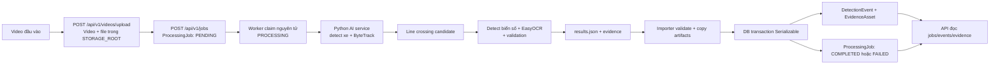

# Traffic Monitoring Backend

Backend Phase 02 cung cấp REST API và PostgreSQL persistence cho camera, video upload, AI processing job, candidate event và evidence. Backend không chạy YOLO trực tiếp; kết quả AI được import từ `results.json` bằng trusted local CLI.

## Yêu cầu

- Node.js `>=22.18`; khuyến nghị Node.js 24 LTS. Node.js 26 hiện tại của workspace cũng được dùng để validate.
- npm 11+.
- PostgreSQL 16+.

## Cài đặt

```bash
cd backend
npm install
cp .env.example .env
```

Tạo PostgreSQL local trên macOS:

```bash
brew install postgresql@18
brew services start postgresql@18
createuser --pwprompt traffic_app
createdb --owner=traffic_app traffic_monitoring
```

Cập nhật mật khẩu trong `DATABASE_URL`, sau đó:

```bash
npm run db:generate
npm run db:migrate
npm run db:seed
npm run dev
```

API: `http://localhost:3000/api/v1`

Swagger: `http://localhost:3000/api/docs`

## Environment

| Biến | Mục đích |
|---|---|
| `DATABASE_URL` | PostgreSQL direct connection URL |
| `PORT` | HTTP port, mặc định 3000 |
| `NODE_ENV` | `development`, `test`, `production` |
| `STORAGE_ROOT` | Root local storage; relative path được resolve từ `backend/` |
| `MAX_UPLOAD_SIZE` | Byte limit cho multipart upload |
| `CORS_ORIGIN` | Danh sách origin cách nhau bởi dấu phẩy |
| `INTERNAL_API_TOKEN` | Token nội bộ bắt buộc trên các route ghi được liệt kê bên dưới |

Không commit `.env`. `storage/`, generated Prisma Client, build và coverage đều bị ignore.

### X-Internal-Token

Các route sau yêu cầu header `X-Internal-Token` trong mọi môi trường: `POST /api/v1/cameras`, `PATCH /api/v1/cameras/:id`, `DELETE /api/v1/cameras/:id`, `POST /api/v1/videos/upload`, `DELETE /api/v1/videos/:id`, `POST /api/v1/jobs`, `PATCH /api/v1/events/:id/review` và `GET /api/v1/evidence/:id/content`. Các route GET khác, health và Swagger vẫn công khai.

Tạo token ngẫu nhiên bằng `openssl rand -hex 32`, rồi đặt vào `INTERNAL_API_TOKEN` trong `.env`. Không dùng giá trị mẫu trong production; server từ chối token mẫu ở môi trường đó. Token thật được chấp nhận trong production. Nếu token chưa cấu hình, route được bảo vệ trả 403; request thiếu hoặc sai token trả 401.

```bash
curl -X POST http://localhost:3000/api/v1/jobs \
  -H "X-Internal-Token: <token>" \
  -H 'Content-Type: application/json' \
  -d '{"videoId":"<video-uuid>"}'

curl -X POST http://localhost:3000/api/v1/videos/upload \
  -H "X-Internal-Token: <token>" \
  -F 'file=@/path/to/input.mp4'
```

## Scripts

```bash
npm run dev
npm run build
npm run start
npm run typecheck
npm run lint
npm test
npm run test:cov
npm run db:validate
npm run db:generate
npm run db:migrate
npm run db:migrate:deploy
npm run db:seed
```

## Luồng dữ liệu



| Bước | Thành phần | File nguồn | Bảng/cột chính |
|---|---|---|---|
| Camera tùy chọn | Backend: `POST /api/v1/cameras` | `src/cameras/cameras.controller.ts`, `src/cameras/cameras.service.ts` | `Camera.id`, `name`, `location`, `status`; `Video.cameraId` tham chiếu `Camera.id`. |
| Upload video | Backend: `POST /api/v1/videos/upload`; ghi file vào local storage rồi tạo metadata | `src/videos/videos.controller.ts`, `src/videos/videos.service.ts`, `src/storage/local-storage.service.ts` | `Video.originalFilename`, `storageKey`, `mimeType`, `fileSize`, `cameraId`; `storageKey` unique. |
| Tạo job | Backend: `POST /api/v1/jobs` tạo trạng thái `PENDING` | `src/processing-jobs/processing-jobs.controller.ts`, `src/processing-jobs/processing-jobs.service.ts` | `ProcessingJob.videoId`, `status`, `createdAt`. |
| Claim và lấy video | Worker đổi job `PENDING` sang `PROCESSING`, rồi dùng `ProcessingJob.videoId` để lấy `Video.storageKey` | `src/worker/ai-job-worker.service.ts` | `ProcessingJob.status`, `startedAt`; video được đọc từ storage, không lấy đường dẫn từ request. Claim dùng `FOR UPDATE SKIP LOCKED`. |
| Phân tích video | Python detect xe, track bằng ByteTrack; chỉ tạo candidate khi track qua vạch; thử nhận diện biển số ở frame candidate | `ai-service/src/traffic_ai/processing/video_processor.py`, `detection/vehicle_detector.py`, `tracking/vehicle_tracker.py`, `violation/line_crossing.py`, `ocr/plate_detector.py`, `ocr/plate_recognizer.py`, `ocr/plate_validator.py` | Python không ghi từng frame thành bản ghi DB. |
| Import summary | Backend validate `results.json`, cập nhật metadata video và trạng thái job trong transaction | `src/ai-results/ai-result.validator.ts`, `src/ai-results/ai-result-import.service.ts` | `Video.width`, `height`, `durationSeconds`; `ProcessingJob.aiSchemaVersion`, `startedAt`, `completedAt`, `totalFrames`, `processedFrames`, `totalEvents`, `errorMessage`, `status`. `summary.job_id` phải khớp job đang import. |
| Import event | Backend upsert candidate theo ID nguồn của Python | `src/ai-results/ai-result-import.service.ts` | `DetectionEvent.sourceEventId`, `trackId`, `eventType`, `reviewStatus`, `vehicleType`, `confidence`, `plateNumber`, `plateRawText`, `plateConfidence`, `frameIndex`, `timestampSeconds`, `crossingDirection`, `rawPayload`. Unique theo `(jobId, sourceEventId)`. |
| Import evidence | Backend copy file vào `STORAGE_ROOT`, rồi upsert asset | `src/ai-results/ai-result-import.service.ts`, `src/storage/local-storage.service.ts` | `EvidenceAsset.assetType`, `storageKey`, `mimeType`, `eventId`, `jobId`; `storageKey` unique; event JPEG/PNG gắn `eventId`, annotated video tùy chọn gắn `jobId`. |
| Đọc và review | Backend đọc job/event/evidence; review nội bộ cập nhật trạng thái review | `src/processing-jobs/processing-jobs.controller.ts`, `src/detection-events/detection-events.controller.ts`, `src/detection-events/detection-events.service.ts`, `src/evidence/evidence.controller.ts` | `GET /api/v1/jobs/:id/events`, `GET /api/v1/events`, `GET /api/v1/evidence/:id/content`; `PATCH /api/v1/events/:id/review` cập nhật `reviewStatus`, `reviewNote`, `reviewedAt`. Review chỉ nhận `VERIFIED_CROSSING` hoặc `REJECTED_CANDIDATE` (không nhận `PENDING_REVIEW`). |

Các khóa ngoại: `Video.cameraId` → `Camera.id` (xóa camera thì đặt null); `ProcessingJob.videoId` → `Video.id` (không xóa video đã có job); `DetectionEvent.jobId` → `ProcessingJob.id`; `EvidenceAsset.jobId` → `ProcessingJob.id`; `EvidenceAsset.eventId` → `DetectionEvent.id`. Quan hệ job/event/evidence dùng xóa dây chuyền. Copy file artifact diễn ra trước transaction; các ghi DB của importer nằm trong transaction `Serializable`.

### Ánh xạ `results.json`

| Trường nguồn | Đích trong database | Ghi chú |
|---|---|---|
| `results.schema_version` (bằng `summary.schema_version`) | `ProcessingJob.aiSchemaVersion` | Phiên bản phải được hỗ trợ và nhất quán với schema ở root, summary và từng event. |
| `summary.status` | `ProcessingJob.status` | `COMPLETED` hoặc `FAILED`. |
| `summary.started_at`, `finished_at` | `ProcessingJob.startedAt`, `completedAt` | `completedAt` null nếu không có `finished_at`. |
| `summary.input_video.width`, `height`, `duration_seconds` | `Video.width`, `height`, `durationSeconds` | `input_video.input_path` và `fps` không có cột riêng trong `Video`. |
| `summary.input_video.reported_total_frames`, `summary.processed_frames` | `ProcessingJob.totalFrames`, `processedFrames` |  |
| `summary.total_candidate_events` | `ProcessingJob.totalEvents` | Validator yêu cầu bằng số phần tử `events`. |
| `summary.error` | `ProcessingJob.errorMessage` |  |
| `events[].event_id` | `DetectionEvent.sourceEventId` | Cùng với `jobId` là khóa idempotency của event. |
| `events[].track_id`, `vehicle_type`, `confidence` | `DetectionEvent.trackId`, `vehicleType`, `confidence` |  |
| `events[].plate_number`, `plate_raw_text`, `plate_confidence` | `DetectionEvent.plateNumber`, `plateRawText`, `plateConfidence` | Giữ nguyên giá trị Python trả về, có thể null. |
| `events[].frame_index`, `timestamp_seconds`, `crossing_direction` | `DetectionEvent.frameIndex`, `timestampSeconds`, `crossingDirection` |  |
| `events[].event_type`, `status` | `DetectionEvent.eventType`, `reviewStatus` | Backend đặt `LINE_CROSSING_CANDIDATE` và `PENDING_REVIEW` sau khi validate giá trị nguồn. |
| Toàn bộ event | `DetectionEvent.rawPayload` | Lưu payload event JSON gốc. |
| `events[].evidence_path` | `EvidenceAsset.storageKey` | File được copy thành `evidence/<jobId>/<eventId>.<ext>` dưới `STORAGE_ROOT`; asset ảnh gắn với event. `storageKey` là unique. |
| `summary.artifacts.annotated_video` | `EvidenceAsset.storageKey` | Nếu có file MP4 hợp lệ, lưu thành `evidence/<jobId>/annotated-video.mp4`; đây là asset cấp job, không gắn event. |

Python là hộp đen đối với backend: backend kiểm tra schema rồi lưu candidate mà Python đưa về; không lưu dữ liệu từng frame. `annotated_video` là tùy chọn. Biển số được lưu đúng như Python trả về, kể cả null. Idempotency dùng `(jobId, sourceEventId)` cho event và `storageKey` cho asset. `PATCH /api/v1/events/:id/review` chỉ ghi nhận review; `VERIFIED_CROSSING` không tự xác nhận vi phạm đèn đỏ hợp pháp.

## Chạy AI worker

Worker chạy AI service Python cho các job `PENDING`, rồi import kết quả vào PostgreSQL. Trước khi chạy worker, cần:

- Python 3.10–3.12 (khuyến nghị 3.11), virtual environment và AI service đã cài editable. Từ repository root:

  ```bash
  python3.11 -m venv .venv
  source .venv/bin/activate
  python -m pip install --upgrade pip
  python -m pip install -e "ai-service[dev]"
  ```

- Hai model weights `ai-service/models/yolov8m.pt` và `ai-service/models/license_plate_detector.pt`. Không commit weights vào Git. Xem [hướng dẫn model](../ai-service/models/README.md).
- PostgreSQL đã chạy, `DATABASE_URL` trỏ tới đúng database, và migrations đã được áp dụng (`npm run db:migrate:deploy`).
- Tạo/cập nhật `backend/.env` theo `.env.example`. Worker đọc cấu hình backend từ `.env` trong thư mục `backend/`.

### Biến môi trường

| Biến | Bắt buộc? | Mặc định | Ví dụ / ràng buộc |
|---|---|---|---|
| `DATABASE_URL` | Có | Không có | PostgreSQL URL hợp lệ; worker dùng kết nối này để claim và cập nhật job. |
| `AI_PYTHON_BIN` | Có | Không có | Đường dẫn tuyệt đối tới Python executable, ví dụ `/repo/.venv/bin/python`; file phải có quyền chạy. |
| `AI_SERVICE_ROOT` | Có | Không có | Đường dẫn tuyệt đối tới thư mục `ai-service/`. |
| `AI_JOB_TIMEOUT_MS` | Có | Không có | Số nguyên dương, không có giới hạn tối đa trong code. Ví dụ `180000`; cần điều chỉnh theo độ dài video và máy. Video 520 frame đã đo mất khoảng 42 giây trong Python nên 180000 ms chỉ là mốc tham khảo. |
| `AI_WORKER_POLL_INTERVAL_MS` | Có | Không có | Số nguyên dương, không có giới hạn tối đa trong code. Ví dụ `1000`. Nếu thiếu hoặc không hợp lệ, worker thoát khi khởi động. |
| `AI_WORKER_CONCURRENCY` | Không | `1` | Số nguyên dương, không có giới hạn tối đa trong code. |
| `AI_KEEP_FAILED_WORKDIR` | Không | `false` | Chỉ nhận chuỗi `true` hoặc `false`; giữ thư mục tạm của job thất bại khi đặt `true`. Job thành công luôn xóa thư mục tạm. |
| `AI_CONFIG_PATH` | Không | Python dùng `ai-service/configs/default.yaml` | Nếu đặt, phải là đường dẫn tuyệt đối tới file đọc được. Đường dẫn model tương đối trong YAML tính từ thư mục cha thứ hai của file config. |
| `TRAFFIC_AI_VEHICLE_MODEL_PATH` | Không | `models/yolov8m.pt` trong AI service | Python override model xe; nên dùng đường dẫn tuyệt đối. |
| `TRAFFIC_AI_PLATE_MODEL_PATH` | Không | `models/license_plate_detector.pt` trong AI service | Python override model biển số; nên dùng đường dẫn tuyệt đối. |
| `TRAFFIC_AI_DEVICE` | Không | `auto` | Python nhận `auto`, `cpu`, `cuda` hoặc `mps`. |

Các biến `TRAFFIC_AI_*` được chuyển sang tiến trình Python. `DATABASE_URL` và `TEST_DATABASE_URL` bị loại khỏi environment của tiến trình con.

### Khởi chạy

Trong terminal backend, build rồi chạy worker bằng JavaScript đã build:

```bash
cd backend
npm run build
npm run worker
```

`npm run worker` chạy `node dist/worker.main.js`; không chạy worker bằng `tsx` vì cần decorator metadata. API chạy riêng trong terminal khác sau khi build:

```bash
cd backend
node dist/main.js
```

### Luồng job và vận hành

`POST /api/v1/jobs` tạo job `PENDING`. Worker claim job cũ nhất đang `PENDING`, chuyển sang `PROCESSING`, chạy Python rồi import `results.json` và evidence. Kết quả kết thúc ở `COMPLETED` hoặc `FAILED`. Worker không tự retry; job `PROCESSING` quá hạn được đánh dấu `FAILED` lúc khởi động worker và trong các lần recovery định kỳ.

Worker sẽ nhặt mọi job `PENDING` trong database đó. Kiểm tra hàng đợi trước khi bật worker, nhất là database có dữ liệu cũ. Đưa video vào storage qua API upload; không thay trực tiếp file video đang lưu vì nhiều job có thể cùng tham chiếu một storage key. Worker lấy video từ `Video.storageKey`, không nhận đường dẫn video từ request.

Khi dừng worker bằng `SIGINT` hoặc `SIGTERM`, Python đang chạy bị dừng và job hiện tại được đánh dấu `FAILED`.

### Xử lý sự cố

- Worker thoát ngay lúc khởi động: kiểm tra các biến bắt buộc phía trên, đặc biệt `AI_WORKER_POLL_INTERVAL_MS`; đường dẫn Python phải tuyệt đối và executable, `AI_SERVICE_ROOT` phải là thư mục.
- Job `FAILED`: xem `errorMessage` của job. Thông báo được giới hạn khoảng 1000 ký tự và đường dẫn tuyệt đối được che.
- Python exit code `2`: thường là lỗi khởi động/configuration; kiểm tra model weights, config và log Python. Worker chuyển job sang `FAILED` nếu Python không tạo được JSON hợp lệ.
- Có vẻ còn tiến trình Python sau khi dừng worker: worker gửi `SIGTERM` cho process group, rồi `SIGKILL` sau khoảng 1 giây nếu tiến trình chưa dừng. Kiểm tra process list trước khi khởi động worker khác.

## AI result import thủ công

1. Tạo video metadata/upload.
2. `POST /api/v1/jobs` để lấy job UUID `PENDING`.
3. Chạy AI service hoặc cung cấp một `results.json` hợp lệ.
4. Import kết quả:

```bash
npm run import:ai -- \
  --job-id <job-uuid> \
  --file /path/to/result-dir/results.json \
  --result-root /path/to/result-dir
```

Importer hỗ trợ schema `1.0`, validate toàn bộ payload trước mutation, dùng transaction, upsert theo `(jobId, sourceEventId)` và copy evidence vào storage boundary. OCR nullable được giữ nguyên. `LINE_CROSSING_CANDIDATE` không được đổi thành kết luận vi phạm đèn đỏ.

## Cấu trúc

```text
backend/
├── prisma/
│   ├── schema.prisma
│   ├── migrations/
│   └── seed.ts
├── src/
│   ├── ai-results/
│   ├── cameras/
│   ├── common/
│   ├── detection-events/
│   ├── evidence/
│   ├── health/
│   ├── prisma/
│   ├── processing-jobs/
│   ├── storage/
│   └── videos/
└── test/
```

## Kiểm thử

Unit tests dùng mock Prisma và synthetic JSON, không cần model weights hoặc PostgreSQL:

```bash
npm test
npm run test:cov
```

Migration/integration test cần một database test riêng. Không trỏ test vào database production hoặc database không rõ nguồn.

```bash
TEST_DATABASE_URL='postgresql://.../traffic_monitoring_test' npm run test:integration
```

Integration test tự skip nếu thiếu `TEST_DATABASE_URL` và từ chối URL có tên database không kết thúc bằng `_test`.

## Giới hạn Phase 02

- Chưa có Redis worker, Docker, frontend, RTSP hoặc production authentication.
- Evidence content/review chỉ có internal development token và bị khóa trong production.
- Không có benchmark AI mới; Backend chỉ persistence/import contract.
- Cần triển khai object storage, retention, audit log đầy đủ và RBAC trước production.
- `npm audit` hiện báo advisory transitively trong Prisma CLI 7.10 (`deepmerge-ts`, `mysql2`); auto-fix đề xuất downgrade Prisma 6 nên không được áp dụng. Cần nâng khi Prisma phát hành bản 7.x đã xử lý và chạy lại validation.

Chi tiết: [kiến trúc](../docs/PHASE_02_ARCHITECTURE.md), [database](../docs/PHASE_02_DATABASE.md), [API](../docs/PHASE_02_API.md).
