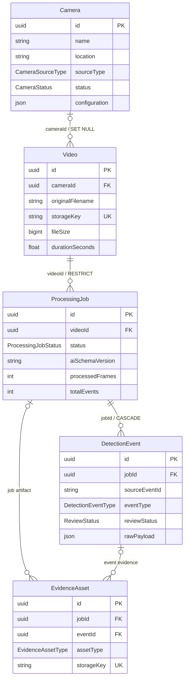

# Phase 02 — Kiến trúc Backend và PostgreSQL

## 1. Kết quả audit repository

Repository hiện có AI core Python modular trong `ai-service/`, source Python legacy ở thư mục gốc và chưa có Backend. Phase 01 không chứa PostgreSQL, NestJS, Redis hoặc Docker.

Nguồn sự thật của hợp đồng AI là `ai-service/src/traffic_ai/schemas.py` và `ResultWriter`:

- `schema_version`: `1.0` ở cấp root, summary và từng event.
- `summary.status`: `RUNNING`, `COMPLETED` hoặc `FAILED`.
- `summary.job_id` và `event.event_id`: UUID dạng chuỗi.
- Event hiện tại chỉ có `LINE_CROSSING_CANDIDATE`; trạng thái AI chỉ có `PENDING_REVIEW`.
- `track_id`, `vehicle_type`, `confidence`, `frame_index`, `timestamp_seconds` và `crossing_direction` được sinh từ pipeline tracking/crossing.
- `plate_number`, `plate_raw_text`, `plate_confidence`, `evidence_path` có thể là `null`.
- `summary.input_video` chứa tên file portable, kích thước, FPS, tổng frame báo cáo và duration.
- `summary.artifacts` chứa các đường dẫn tương đối. Evidence hiện có dạng `evidence/<event_uuid>.jpg`.
- `results.json` được ghi atomically. JSON là output chính; CSV/SQLite chỉ là compatibility tùy chọn.

Backend không thay đổi contract Python. Mọi khác biệt được xử lý ở lớp mapping.

## 2. Kiến trúc Backend mục tiêu

```text
HTTP client
    |
    v
NestJS Controller -> DTO validation -> Service -> PrismaService -> PostgreSQL
                              |
                              `-> LocalStorageService -> backend/storage

Trusted local CLI
    |
    v
AiResultImportService
    |-- validate schema 1.0 + UUID + nullable values
    |-- resolve/copy evidence trong trusted result root
    `-- transaction -> ProcessingJob + DetectionEvent + EvidenceAsset
```

Module chính:

- `cameras`: metadata camera; chưa kết nối RTSP.
- `videos`: upload/list/detail/delete metadata và liên kết camera.
- `processing-jobs`: tạo và truy vấn job; chưa gọi Python hoặc queue.
- `detection-events`: truy vấn candidate và review nội bộ.
- `evidence`: trả metadata evidence; không lộ đường dẫn filesystem tuyệt đối.
- `ai-results`: validation/mapping/import CLI, không mở public import endpoint.
- `storage`: abstraction local storage, có thể thay bằng S3/MinIO ở phase sau.
- `health`: liveness và database readiness tách biệt.

Controller không truy vấn Prisma trực tiếp. Business rule và transition nằm trong service.

## 3. Thiết kế dữ liệu



`EvidenceAsset` gắn đúng một trong `jobId` hoặc `eventId`; migration thêm `CHECK` để bảo đảm XOR. Video không bị xóa cascade. Xóa camera dùng `SET NULL`, giữ lịch sử video. Event ID từ AI được lưu ở `sourceEventId`; unique `(jobId, sourceEventId)` bảo đảm idempotency mà không giả định track ID là global.

## 4. Mapping JSON AI → PostgreSQL

| JSON Phase 01 | PostgreSQL | Quyết định |
|---|---|---|
| `summary.job_id` | `ProcessingJob.id` | Phải trùng `--job-id` |
| `schema_version` | `ProcessingJob.aiSchemaVersion` | Chỉ hỗ trợ `1.0` |
| `event_id` | `DetectionEvent.sourceEventId` | UUID nguồn, unique trong job |
| `event_type` | `DetectionEvent.eventType` | Chỉ `LINE_CROSSING_CANDIDATE` |
| `status` | `DetectionEvent.reviewStatus` | `PENDING_REVIEW`; review sau import |
| `crossing_direction` | `DetectionEvent.crossingDirection` | Giữ field thật của AI |
| OCR fields | các cột nullable tương ứng | Không tạo confidence/plate giả |
| event object | `rawPayload` | Giữ payload gốc phục vụ audit/debug |
| `evidence_path` | `EvidenceAsset.storageKey` | Validate relative path và copy vào storage boundary |
| `summary.artifacts.annotated_video` | Evidence của job | Chỉ import khi path hợp lệ và file tồn tại |

`started_at`/`finished_at` là thời gian xử lý, không phải thời điểm camera ghi hình. Vì Phase 01 không cung cấp timestamp tuyệt đối của video, `detectedAt` để `null`; không suy diễn dữ liệu.

## 5. File storage

- PostgreSQL chỉ lưu metadata/storage key, không lưu binary.
- Upload được kiểm tra extension, MIME, signature cơ bản và size trước khi ghi.
- Tên nội bộ là UUID, không dùng path từ client.
- Storage key dùng slash portable và luôn được resolve dưới `STORAGE_ROOT`.
- Import CLI nhận `--result-root` là thư mục trusted. Mọi artifact phải là relative path, không có `..`, không symlink thoát root.
- Public response không trả absolute filesystem path.
- Uploaded video/evidence và `.env` được ignore khỏi Git.

## 6. API và boundary bảo mật

Global prefix là `/api/v1`; Swagger ở `/api/docs`. DTO bật transform, whitelist và reject field không khai báo.

Import AI chỉ có local CLI, không có HTTP endpoint. `PATCH /events/:id/review` yêu cầu `X-Internal-Token`; nếu token chưa cấu hình hoặc môi trường production thì endpoint từ chối. Đây chỉ là boundary phát triển, không thay thế authentication/RBAC.

Error response có cấu trúc ổn định và không trả stack trace/path nội bộ trong production. Prisma dùng parameterized query. CORS, upload limit và storage root lấy từ environment.

## 7. Transaction và idempotency

- Payload được validate hoàn toàn trước mutation.
- Import `COMPLETED` dùng một database transaction để upsert event/evidence và cập nhật job sau cùng.
- Import lặp lại dùng composite unique `(jobId, sourceEventId)` và storage key deterministic.
- Payload `FAILED` chỉ cập nhật job chưa có kết quả hợp lệ; không ghi đè job đã `COMPLETED`.
- Payload malformed hoặc import lỗi không xóa event hợp lệ có sẵn.
- File đã copy trong lần import lỗi được cleanup best-effort.

## 8. Giới hạn và quyết định kỹ thuật

- Phase 02 không chạy Python, không Redis, không RTSP, không Frontend và không Docker.
- Review `VERIFIED_CROSSING` chỉ xác nhận crossing qua vạch, không xác nhận vi phạm đèn đỏ hợp pháp.
- Camera `configuration` là JSON nullable để dành chỗ line/zone metadata; không lưu credentials.
- Prisma ORM 7 dùng generator `prisma-client`, `prisma.config.ts` và `@prisma/adapter-pg`, tránh mẫu connection cũ.
- NestJS 12 và Prisma 7 yêu cầu Node.js runtime tương thích; dự án khuyến nghị Node.js 24 LTS và đặt minimum `22.18`.
- Migration SQL được version control; không dùng `db push` thay migration.
- Nếu máy không có PostgreSQL local, Prisma schema/client, build và unit test vẫn được kiểm tra; migration/integration test được báo blocked thay vì giả lập kết quả.

## 9. Tài liệu chính thức đã đối chiếu

- [Prisma ORM 7 với NestJS](https://www.prisma.io/docs/guides/v7/frameworks/nestjs)
- [Prisma ORM 7 PostgreSQL driver adapter](https://www.prisma.io/docs/orm/v7/core-concepts/supported-databases/postgresql)
- [NestJS validation](https://docs.nestjs.com/application/validation)
- [NestJS file upload](https://docs.nestjs.com/http/file-upload)
- [NestJS Swagger](https://docs.nestjs.com/openapi/introduction)
