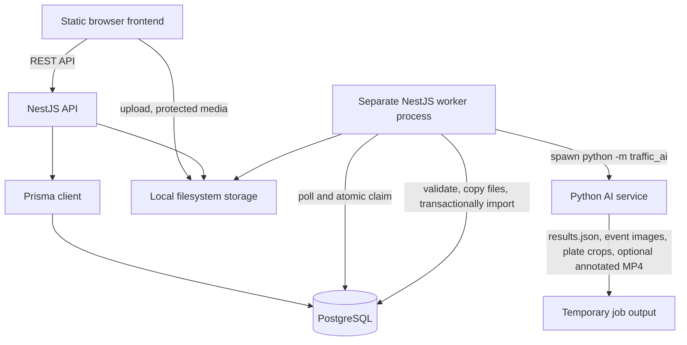
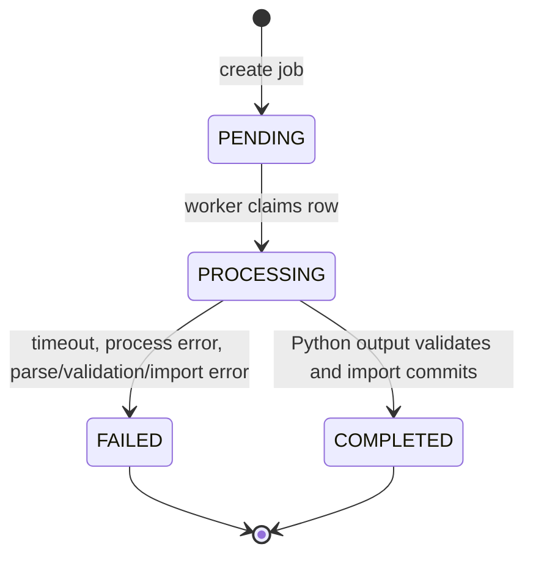

# Technical Audit — AI Traffic Monitoring System

**Audit scope:** source, configuration, tests, tracked documentation, Git path/history metadata, and selected tracked demo assets. This is a code/documentation audit, not a live service, database, or model benchmark. No application code, database, worker job, or migration was changed or run for this audit.

## Executive Summary

The repository contains a connected MVP: a Python computer-vision CLI, a TypeScript/NestJS API, PostgreSQL persistence through Prisma, a database-polling worker that invokes Python, and a static browser frontend. The inference path uses pretrained local YOLO checkpoints, configured vehicle tracking, a virtual-line crossing rule, and a separate plate detector plus EasyOCR. Results are validated against a strict schema before transaction-based import.

The system emits `LINE_CROSSING_CANDIDATE` events. It does not detect traffic-light state or establish a legal red-light violation. The source contains tests for important units and integration boundaries, but no formal detection/OCR accuracy evaluation and no automated browser end-to-end suite. Key practical risks are low plate-crop resolution, model weights not being part of the repository, worker retry limitations, contract drift across Python and TypeScript, local-storage dependence, and privacy/factual problems in tracked demo screenshots.

## Audit Method and Evidence Boundaries

- Inspected `ai-service/src/traffic_ai/`, `ai-service/configs/`, `ai-service/tests/`, `backend/src/`, `backend/prisma/`, `frontend/`, root and component READMEs, test notes, GitHub workflow files, `.gitignore`, and tracked demo screenshots.
- Inspected source and configuration as the primary evidence. UI controls are not treated as proof of a working API path unless a corresponding client call and backend route exist.
- Did not connect to PostgreSQL, call a running API, run a job, load model weights, or run test suites during this documentation update.
- Historical test outputs listed below are prior local workspace evidence, not tests executed during this audit.
- Secret checks were pattern-based and path/history-oriented; they are not a substitute for a dedicated secret scanner or legal/privacy review.

## Verified Architecture

### Component boundaries

| Component | Entry point and responsibility | Status |
|---|---|---|
| Static frontend | `frontend/*.html`, `frontend/js/api.js`, `frontend/js/app.js`; calls REST endpoints and displays operator workflows | Implemented; no automated browser test suite found |
| API server | `backend/src/main.ts`; NestJS, global validation, CORS, Swagger, exception filter, controllers and services | Implemented; unit tests exist |
| Worker | `backend/src/worker.main.ts`; separate Nest application context and job-polling service | Implemented; tests cover job/error paths |
| Python inference | `ai-service/src/traffic_ai/__main__.py`; CLI configures detectors and processes frames | Implemented; model-backed path requires local weights |
| Persistence | `backend/prisma/schema.prisma`, SQL migrations, Prisma service | Implemented in source; no live database was accessed in this audit |
| Artifact storage | `LocalStorageService` under configured storage root | Implemented; local filesystem only |

## AI Pipeline Findings

### Vehicle detection and tracking

`VehicleDetector` loads a configured local checkpoint through `ultralytics.YOLO`. The default path is `models/yolov8m.pt`; the repository also expects a separate plate-detection checkpoint. Model files are ignored by Git and documented as separately provisioned. No training or fine-tuning code or verified training artifact is present.

The default vehicle inference configuration targets `car`, `motorcycle`, `bus`, and `truck`, with confidence `0.30`, IoU `0.50`, and image size `640`. It calls inference per decoded video frame and uses Ultralytics' tracking method with `configs/bytetrack.yaml` and persistent tracking. `device: auto` leaves device selection to the runtime. Code supports explicit device values but does not establish that a particular accelerator is available or used in a given run.

Detection boxes are parsed into structured boxes and clipped to frame dimensions. Invalid or missing configured classes cause initialization failure. Inference exceptions are wrapped in detector-specific errors. There is no repository-level benchmark for detection quality, throughput, or hardware performance.

### Line-crossing event rule

`LineCrossingDetector` stores side-of-line state keyed by tracker ID, uses the vehicle bounding box bottom-center point, applies tolerance/hysteresis and stale-track expiry, and emits a transition only when configured direction matches. The default line is horizontal at normalized `y=0.48`, direction `positive_to_negative`, tolerance 8 px, and repeated crossings disabled. Events are candidates; no signal color or legal context is evaluated.

### Plate detection and OCR

At a crossing transition, `PlateDetector` applies a separate YOLO model to the corresponding vehicle ROI and maps plate boxes back to the source frame. Returned crops are sorted by plate-detector confidence; processing uses the leading crop. Minimum crop dimensions control saving of plate-crop evidence. This is not OCR confidence aggregation across frames.

`PlateRecognizer` wraps EasyOCR. Its optional preprocessing uses grayscale conversion, bilateral filtering, histogram equalization, adaptive thresholding, morphological closing, and sharpening. `PlateValidator` cleans text, tests configured Vietnamese plate shapes, performs role-based character substitutions, and applies its minimum OCR confidence threshold. The result contract separately carries normalized plate value, raw OCR text, and plate confidence. A rejected/insufficient result can yield a null normalized plate. No temporal OCR voting is implemented.

### Event semantics and scope

The only event enum in Prisma is `LINE_CROSSING_CANDIDATE`; default review status is `PENDING_REVIEW`. Human review can set `VERIFIED_CROSSING` or `REJECTED_CANDIDATE`. The data model does not include a traffic-light observation or legal adjudication. “Verified crossing” should not be described as a verified red-light violation.

### Resolution observation

Existing project documentation records a 7.mp4 observation at 1920×1080 with 48 line-crossing tracks. At the crossing frame, 22 tracks had a plate crop: median width 34 px, P90 38.6 px, maximum 45 px. During the next 30 frames, 25 tracks had a crop: median best width 34 px, P90 43.2 px, maximum 59 px. No track reached 60 px, and median gain was about 1 px. The project documentation says best-of-next-frame selection was not implemented. This is a crop-size observation, not an OCR accuracy benchmark.

## Backend and API

The backend uses NestJS 12, TypeScript, class-validator, Swagger, Prisma 7 with the PostgreSQL adapter, and a global `/api/v1` prefix. `ValidationPipe` uses transformation, `whitelist: true`, and `forbidNonWhitelisted: true`; unknown DTO fields are rejected. A shared exception filter handles API exceptions. CORS origins are configured by `CORS_ORIGIN`; the allowed headers include `X-Internal-Token`, `Range`, and `If-Range`.

### API route inventory

| Method | Endpoint | Purpose | Implementation status |
|---|---|---|---|
| GET | `/health`, `/health/live`, `/health/ready` | Health/readiness | Implemented |
| GET, POST | `/cameras` | List/create cameras | Implemented; POST guarded |
| GET, PATCH, DELETE | `/cameras/:id` | Camera detail/update/delete | Implemented; mutations guarded |
| POST | `/videos/upload` | Multipart upload and metadata creation | Implemented; guarded |
| GET | `/videos` | Paginated/filterable video list | Implemented |
| GET | `/videos/:id` | Video metadata | Implemented |
| GET | `/videos/:id/jobs` | Jobs by video | Implemented |
| GET | `/videos/:id/content` | Protected original video stream, including byte ranges | Implemented; guarded |
| DELETE | `/videos/:id` | Delete video | Implemented; guarded, relational constraints apply |
| GET, POST | `/jobs` | List/create processing jobs | Implemented; POST guarded |
| GET | `/jobs/:id` | Job detail including `annotatedVideoAvailable` | Implemented |
| GET | `/jobs/:id/events` | Events associated with job | Implemented |
| GET | `/jobs/:id/annotated-video` | Protected annotated video stream with byte ranges | Implemented; guarded |
| GET | `/events` | Filtered/paginated event list | Implemented |
| GET | `/events/:id` | Event detail | Implemented |
| GET | `/events/:id/evidence` | Event evidence metadata | Implemented |
| PATCH | `/events/:id/review` | Update human review result/note | Implemented; guarded |
| GET | `/evidence/:id/content` | Protected evidence content | Implemented; guarded |
| GET | `/stats/overview` | Aggregate counts | Implemented |
| GET | `/stats/events` | Group events by UTC day, vehicle type, or review status | Implemented |
| CLI | `npm run import:ai` | Trusted local AI result import | Implemented; not a public endpoint |

The shared internal token is a service-level guard rather than user authentication or role-based authorization. The route-specific list is in `backend/README.md`. The API stores uploaded and generated media under local `STORAGE_ROOT`; there is no object-storage adapter.

## Data Model and Consistency

| Model | Confirmed fields / relationship |
|---|---|
| `Camera` | Name, location, description, source type/status, optional JSON configuration; one-to-many videos |
| `Video` | Original filename, unique storage key, MIME type, BigInt size, optional duration/dimensions, nullable camera relation |
| `ProcessingJob` | Required video relation; PENDING/PROCESSING/COMPLETED/FAILED; schema version, frame counts, event count, start/end times, error text |
| `DetectionEvent` | Job relation, source event ID, nullable track/vehicle/plate/confidence/timing data, review state/note, raw payload JSON |
| `EvidenceAsset` | IMAGE/PLATE_CROP/ANNOTATED_VIDEO/OTHER; unique storage key; nullable job/event IDs with database ownership constraint; MIME type |

The event identity is unique on `(jobId, sourceEventId)`. Jobs reference videos with delete restriction; events and assets have cascading parent relations as configured. Confidence, size, and timing constraints/indexes are described in Prisma and SQL migration files. The importer validates the AI document, copies safe artifact paths into storage, and writes event/evidence/job changes in a serializable transaction. It attempts to clean copied files if a transaction fails. No live database integrity or migration execution was verified in this audit.

## Processing Lifecycle and Failure Analysis

The worker polls PostgreSQL and claims a job atomically using `FOR UPDATE SKIP LOCKED`. It starts the configured Python executable via `spawn`, sets the AI service as working directory, passes video/output/job ID arguments, and supplies `--config` only when an override is configured. Python writes to a temporary job directory. The worker parses `results.json`, invokes the importer, then removes temporary output on success; failed workdir retention is configurable. The child environment omits database URLs. The worker has timeout and process cancellation handling. Startup recovery marks stale `PROCESSING` jobs as failed; no automatic retry/backoff queue is present.

### `AI result JSON không hợp lệ`

This message is emitted by `AiResultImportService` when the JSON document has been parsed but is rejected by `validateAiResult`. The validator checks supported schema versions (`1.0`, `1.1`, `1.2`), matching root/summary/event versions, DTO constraints, event count consistency, artifact-path safety, crop-reason rules, and strict unknown-field rejection. The worker stores the resulting safe error text and logs it with the job ID. A different worker error is used when Python did not produce parseable `results.json`.

No failed-job payload or corresponding runtime log was inspected as part of this audit, so a specific root cause for an observed failure cannot be named. To diagnose one safely, preserve the failed job's non-sensitive validation message and inspect a redacted result document outside the database; do not loosen the whitelist or expose absolute paths, tokens, or plate values in public logs.

## Frontend Findings

The frontend is static HTML, CSS, and JavaScript; no framework, package manifest, or frontend build pipeline was found. `ApiClient` centralizes API requests and token handling; page-specific logic is in `app.js`. The pages include dashboard, violations list/detail, jobs/videos, camera management, plate crops, and replay.

Token input is stored in `sessionStorage`. Protected mutations and media retrieval use `X-Internal-Token`. Evidence and video are fetched as blobs to attach the header. The replay page loads the original `GET /videos/:id/content` stream as a blob, then seeks to timestamps from precomputed events. It explicitly describes replay as previously processed, not real-time inference. Although the backend provides an annotated-video endpoint, current replay code does not call it.

The UI source provides pagination/filtering, job polling, upload, camera forms, review actions, event evidence, and status/error states. No browser automation or frontend smoke-test suite is tracked, so live browser behavior is not fully verified by this audit.

## Capability Classification

| Feature | Classification | Evidence / qualification |
|---|---|---|
| Vehicle YOLO inference | Implemented, not fully tested end-to-end here | Detector unit tests exist; real model path depends on local checkpoint |
| Vehicle tracking | Implemented, not fully tested on varied footage | Tracker adapter and tests exist; no broad tracking evaluation |
| Virtual-line candidate events | Implemented and unit-tested | Geometry/crossing tests; does not determine traffic-light state |
| Plate-region detection | Implemented, not fully evaluated | Separate detector and pipeline tests; low-resolution crop limitation documented |
| OCR and normalization | Implemented, not accuracy-benchmarked | EasyOCR wrapper, preprocessing, validator tests; no labeled accuracy set |
| AI result serialization/import | Implemented and unit-tested | Python schema/writer and backend validator/importer tests |
| Job worker lifecycle | Implemented, not operationally load-tested | Polling, atomic claim, timeout/error, stale recovery in source |
| PostgreSQL persistence | Implemented in source, live state not audited | Prisma schema/migrations and service tests; no DB connection in this audit |
| Original/annotated media streaming | Implemented in source, API not live-tested | Guarded controllers, safe storage, Range helper, unit tests |
| Static frontend workflows | Implemented, browser behavior not fully tested | Source and API calls exist; no browser E2E suite found |
| Annotated-video production | Optional/experimental operational artifact | Enabled in default config; requires local ffmpeg; best-effort so absence should not fail job |
| Training/fine-tuning | Planned/not present | No training code or tracked weights verified |
| Traffic-light or legal violation classification | Not implemented | No corresponding signal-state model/rule or schema field |
| Formal AI performance evaluation | Not implemented | No verified mAP/OCR accuracy/FPS artifact |
| Production deployment | Planned/not documented as runnable deployment | No tracked Docker/Compose or deployment manifest found |

## Testing Evidence and Metrics

### Tests present

- Python: configuration, geometry, line crossing, tracking, vehicle detector, plate pipeline, plate validation, schema, result writer, and video processor tests; one real-pipeline integration test is marked as requiring external assets.
- Backend: controller/service/DTO validation, API validation, job state, AI schema/import, worker failures, video validation, and protected-content stream tests.
- CI: `.github/workflows/python-ai-ci.yml`, `.github/workflows/backend-ci.yml`, and `.github/workflows/postgres-integration.yml` exist.

### Prior local run evidence (not run during this audit)

On 2026-11-03, prior workspace execution recorded:

- AI service: `pytest` — 48 passed, 1 skipped; the skip was an asset-gated integration test.
- Backend: Jest — 14 suites passed, 1 suite failed; 63 tests passed and 8 failed. The failing HTTP guard suite could not bind its local loopback listener in the sandbox (`listen EPERM`).
- Backend `tsc --noEmit` and ESLint on the then-modified files passed.
- Annotated-video focused test had passed with ffmpeg available in that earlier task context.

These are historical local results and do not describe a fresh full test run at audit time. The current documentation task did not execute tests, typecheck, lint, a live HTTP request, or PostgreSQL integration tests.

### Metrics absent

No verified mAP, precision/recall, OCR accuracy, false-positive/false-negative rates, FPS, latency distribution, or scale/load result is published. The crop-width observation above is not a quality benchmark. A useful future evaluation should use authorized, labeled footage, split by camera/time, report detection and OCR metrics separately, include null/unreadable rate and confidence calibration, and record hardware/software/model versions.

## Documentation Inconsistencies

- The former root README described an older backend-only phase and stale schema support; current source includes the frontend, a worker, schema versions through `1.2`, and annotated-video delivery.
- `backend/README.md` contains useful current worker and endpoint notes but parts of its schema mapping still describe older schema-version behavior (for example, crop-reason/schema support should be checked against the validator before relying on that table).
- Historical Phase 01/02 docs and test reports describe earlier milestones and should be clearly labeled historical rather than treated as the current architecture.
- The default YAML includes a `schema_version` key, while Python event/result dataclasses derive their serialized version from `SCHEMA_VERSION`; code review should confirm whether that YAML key is intentionally unused and either document or remove it in a separate code change.
- The repository's old screenshots and legacy scripts use stronger violation wording than the current event contract supports.

## Security and Portfolio Review

### Current-tree checks

- `.gitignore` excludes `frontend/js/config.js`, local storage, video files, model weights, local databases, and generated output except for three explicitly re-included JPEG screenshots.
- `backend/.env.example` is tracked as an environment template. The actual `backend/.env` was not opened or printed.
- A basic pattern scan of tracked current files for common cloud/API/private-key token shapes found no matches. This is not proof that all secrets are absent; run a dedicated scanner before publication and inspect findings without copying values into reports.
- The example frontend config contains a localhost API URL and no token. The active ignored frontend config was not read.

### Public artifact risks

- `output/violation_1.jpg`, `output/violation_2.jpg`, and `output/violation_3.jpg` are tracked and visually contain readable plate details plus the legacy label “Vuot den do!”. The images were not reproduced in this report. Before public portfolio use, remove identifying regions through a reviewed redaction workflow and replace the assertion with neutral candidate language. Do not assume adding a note in README makes the original images safe.
- Git history path inspection found historical paths for `7.mp4`, YOLO `.pt` files, and `output/annotated_video.mp4`. File contents were not printed. Because removal from the current tree does not erase public Git history, check repository access and licensing/privacy; if exposure is confirmed, coordinate repository-owner review and a history-cleanup plan. Do not rewrite history without coordination.
- Root-level scripts such as `traffic_violation_detection.py` and `license_plate_recognition.py` are legacy standalone prototypes. They should not be conflated with the current modular AI service; some older output/label behavior may be less safe or less accurate.
- Internal token protection is not user authentication. Do not expose the MVP publicly with a shared long-lived internal token as its only access control.

### Secret/data handling limits

This audit did not inspect `.env` contents, print database URLs, reveal tokens, print plate strings, query a database, or copy any video/model artifact. Git history was examined by path metadata for potentially sensitive artifact names only. A full privacy review should check ownership/consent for footage and model redistribution rights.

## Suggested Engineering Improvements

1. Add a shared contract fixture generated by Python and validated by TypeScript for every supported schema version, including strict unknown-field and nullability cases.
2. Add a redacted, reproducible validation report for failed jobs, with field paths and constraints but no absolute paths, token values, or plate data.
3. Define an authorized labeled evaluation set and measure vehicle detection, line-crossing events, plate detection, OCR exact match, unreadable rate, and confidence calibration separately.
4. Add browser end-to-end tests for token handling, upload, job state, event review, evidence fetch, replay, and error handling with fake API routes.
5. Add worker retry/backoff and dead-letter/operational recovery policy with idempotency tests; preserve current transaction and event identity guarantees.
6. Add retention and access controls for source videos, plate crops, event images, and annotated video; document data handling and deletion.
7. Consider object storage and a durable queue only with explicit operational requirements; retain safe storage-key/path validation and byte-range streaming.
8. Redact tracked demo screenshots and remove or neutralize affirmative violation labels before portfolio publication.
9. Clarify whether the YAML `schema_version` field is intentionally ignored by the Python loader; make one source of truth explicit.
10. Update historical phase docs and `backend/README.md` so current schema versions, worker behavior, and API routes are consistent.

## Files Consulted (Representative)

- AI service: `ai-service/src/traffic_ai/__main__.py`, `config.py`, `schemas.py`, `detection/vehicle_detector.py`, `tracking/vehicle_tracker.py`, `violation/line_crossing.py`, `ocr/plate_detector.py`, `ocr/plate_recognizer.py`, `ocr/plate_validator.py`, `processing/video_processor.py`, `processing/visualization.py`, `storage/result_writer.py`, `configs/default.yaml`, `configs/bytetrack.yaml`, `tests/`.
- Backend: `backend/src/main.ts`, controllers/services under `cameras/`, `videos/`, `processing-jobs/`, `detection-events/`, `evidence/`, `stats/`, `worker/`, `ai-results/`, `storage/`, `backend/prisma/schema.prisma`, `backend/prisma/migrations/`, `backend/package.json`.
- Frontend: `frontend/*.html`, `frontend/js/api.js`, `frontend/js/app.js`, `frontend/js/config.js.example`, `frontend/css/style.css`.
- Project operations/docs: root `README.md`, `backend/README.md`, `ai-service/README.md`, `ai-service/models/README.md`, `docs/`, `.github/workflows/`, `.gitignore`, tracked `output/` screenshots.
